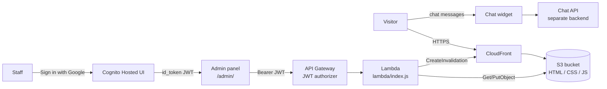

# 🌿 Serenity Spa & Wellness Website


A static website for a **fictional** Portland spa, plus an OAuth-protected admin panel and an embeddable AI chat widget. The public site is plain HTML, CSS and JavaScript with no build step; the admin backend runs on AWS Cognito, API Gateway and Lambda.

**[🚀 Live Demo](https://d3otg5fszt3roj.cloudfront.net/)** • **[🔐 Admin Panel](https://d3otg5fszt3roj.cloudfront.net/admin/)** • **[📖 Admin Setup Guide](README-admin.md)** • **[☁️ AWS Hosting Guide](aws-deploy.md)** • **[💬 Knowledge Base](knowledge-base.md)**

---

## Contents

- [What this project shows](#what-this-project-shows)
- [Architecture](#architecture)
- [How the pieces work](#how-the-pieces-work)
- [Project structure](#project-structure)
- [Run it locally](#run-it-locally)
- [Tests](#tests)
- [Deployment](#deployment)
- [Known limitations & roadmap](#known-limitations--roadmap)
- [Customization](#customization)

---

## What this project shows

| Area | What's here |
|------|-------------|
| **Frontend fundamentals** | 6 responsive pages, mobile-first CSS (Grid/Flexbox, custom properties), ~400 lines of framework-free JS |
| **Accessibility** | Semantic landmarks, keyboard-navigable accordions and menu, ARIA states, live regions, linked form errors |
| **Static hosting on AWS** | S3 origin behind CloudFront (HTTPS, caching, invalidations) |
| **Authentication** | OAuth 2.0 authorization-code flow: Google → Cognito Hosted UI → JWT, with `state` CSRF check |
| **Serverless API** | API Gateway JWT authorizer → one Lambda that reads/writes site files in S3 and invalidates CloudFront |
| **AI integration** | Embeddable chat widget + a 50-entry structured Q&A file designed for RAG / vector-DB ingestion |

---

## Architecture



---

## How the pieces work

### Public site (`*.html`, `css/styles.css`, `js/main.js`)
Every page shares the same header, footer and stylesheet. `js/main.js` is one IIFE split into numbered sections; each section checks whether its elements exist, so the same file runs safely on every page:

1. **Navigation** — scroll shadow, hamburger menu (closes on link click, outside click, or Escape), current-page highlighting
2. **FAQ accordion** — one panel open at a time, Arrow/Home/End keyboard support, `aria-expanded`
3. **Treatment filter** — category buttons toggle cards and announce the result count to screen readers
4. **Contact form validation** — rules declared in HTML (`data-validate="required|email"`), validated on blur and submit; submission is simulated (no backend)
5. **Smooth scroll** for in-page links, offset by the sticky nav height
6. **Helpers** — screen-reader announcer and scroll-triggered entrance animations

### Admin panel (`admin/`)
- **`admin-auth.js`** — the sign-in flow. Redirects to Cognito with a random `state`, verifies it on return, swaps the one-time `code` for an `id_token`, and stores it. `AdminAuth.request()` wraps `fetch` with the Bearer token and logs out on a 401.
- **`admin-main.js`** — shared helpers: toasts, nav highlighting, `escapeHtml()`, and `saveFile()` (the single place that PUTs to the API).
- **`*-editor.js`** — one file per editor page. Each loads its target file from the API, parses it with `DOMParser`, renders a list, and saves on add/edit/delete.

### Admin API (`lambda/index.js`)
One Lambda serves all routes. API Gateway has already verified the JWT, so the handler reads the user's email from the passed-in claims.

| Method | Endpoint | Description |
|--------|----------|-------------|
| `GET` | `/admin/api/content?file={name}` | Read a whitelisted file from S3 |
| `PUT` | `/admin/api/content` | Write a whitelisted file, then invalidate it in CloudFront |
| `GET` | `/admin/api/me` | Return the signed-in user's email/name |

Safeguards: a file whitelist (no arbitrary S3 keys), and HTML writes are rejected with **422** unless they're a complete document, so a bad save can't wipe a live page.

### Chat widget (`widget/serenity-widget.js`)
A single-file, dependency-free ES5 script any site can embed. It injects its own `sw-`-prefixed styles, renders a launcher and chat panel, and POSTs messages to a configurable API. Included on `index.html`.

---

## Project structure

```
spa_test_website/
├── index.html, treatments.html, services.html,
│   about.html, contact.html, faq.html     ← public pages
├── css/styles.css                         ← site styles (design tokens in :root)
├── js/main.js                             ← site interactivity
├── widget/serenity-widget.js              ← embeddable AI chat widget
├── admin/
│   ├── index.html                         ← login (Google via Cognito)
│   ├── dashboard.html                     ← editor hub
│   ├── *-editor.html                      ← 6 editor pages
│   ├── css/admin-styles.css
│   └── js/
│       ├── admin-config.js                ← Cognito/API settings (generated by setup.sh)
│       ├── admin-auth.js                  ← OAuth flow + authenticated fetch
│       ├── admin-main.js                  ← shared UI helpers + saveFile()
│       └── *-editor.js                    ← per-page editor logic
├── lambda/
│   ├── index.js                           ← admin API handler
│   ├── index.test.js                      ← unit tests (node:test)
│   └── package.json
├── knowledge-base.md                      ← 50 Q&A pairs for RAG
├── aws-deploy.md                          ← hosting setup guide
└── README-admin.md                        ← admin panel setup guide
```

> `setup.sh` and `aws-deploy.sh` are deployment scripts kept out of git (see `.gitignore`) because they contain account-specific values.

---

## Run it locally

```bash
npm install
npm start            # http://localhost:8080
# or, with no Node:
python3 -m http.server 8080
```

To click through the admin UI without AWS, set `devMode: true` in `admin/js/admin-config.js` (don't commit that change). Pages render, but loading/saving content still needs the deployed API.

---

## Tests

The Lambda's request validation is covered by unit tests that run without AWS credentials:

```bash
cd lambda
npm install
npm test
```

---

## Deployment

Full walkthroughs: [aws-deploy.md](aws-deploy.md) (site) and [README-admin.md](README-admin.md) (admin backend).

```bash
# Sync the site (skip docs, scripts and tooling)
aws s3 sync . s3://serenity-spa-wellness-site/ \
  --delete \
  --exclude ".git/*" --exclude "*.sh" --exclude "*.md" \
  --exclude "node_modules/*" --exclude "lambda/*" --exclude "package*.json"

# Clear the CDN cache
aws cloudfront create-invalidation --distribution-id E394G7D2J8ETX3 --paths "/*"
```

After changing `lambda/index.js`, redeploy the function (zip `index.js` + `node_modules`, or use `setup.sh`).

---

## Known limitations & roadmap

Being upfront about what isn't finished:

- **Treatments, Team, FAQ, Hours and Pricing editors don't match the live page markup yet.** They look for attributes like `data-treatment-id` and `data-faq-id`, which the public pages don't use, so their lists load empty. They also generate a fragment of HTML rather than a full page; the Lambda now rejects those saves (422) instead of overwriting the live page. The Pricing editor also targets `pricing.html`, which doesn't exist (tiers live in `services.html`).
  **Planned fix:** add stable `data-*` hooks to the public pages, have each editor update only its section of the full page it loaded, and save the whole document.
- **The Knowledge Base editor is fully working** — it round-trips `knowledge-base.md` byte-for-byte.
- The contact form simulates submission; connect Formspree, SES or a Lambda to make it real.
- Tokens are kept in `localStorage`, which is common for SPAs but readable by any script on the admin origin. HttpOnly cookies via a backend would be the hardened version.
- Hosting is set up through CLI scripts rather than infrastructure-as-code; a CDK or Terraform version would make it reproducible.

---

## Customization

| What | Where |
|------|-------|
| Business name, address, phone, email | Search-and-replace across the HTML files (`Serenity Spa & Wellness`, `(555) 123-4567`, `hello@serenity-spa.com`, ...) |
| Brand colors | `:root` tokens at the top of `css/styles.css` (`--clr-primary`, `--clr-accent`, ...) |
| Treatments & prices | `<article class="treatment-card">` blocks in `treatments.html` |
| Team | `<article class="team-card">` blocks in `about.html` |
| Hours | Hours table in `contact.html` and the footer of each page |
| Chat widget | `DemoChat.init({...})` at the bottom of `index.html` |

---

**Serenity Spa & Wellness is a fictional business** created for portfolio purposes.

Built with HTML5, CSS3, vanilla JavaScript and Node.js · Auth: AWS Cognito + Google OAuth 2.0 · Hosted on S3 + CloudFront · API: API Gateway + Lambda
